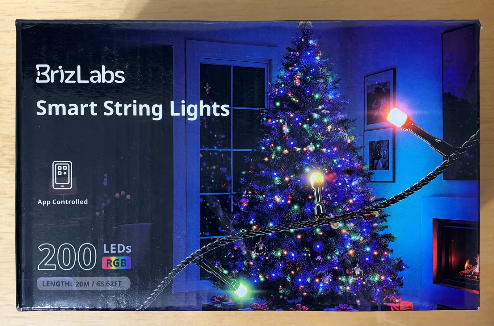

<!-- Describe the device here. See the front-matter table on the contributing page for valid options. -->

## Basic Configuration

```yaml
# BrizLabs 200-LED string controller (ESP32-C2 / ESP8684H). Secrets in secrets.yaml (gitignored).

esphome:
  name: brizlabs-lights
  friendly_name: BrizLabs Lights

esp32:
  variant: esp32c2
  flash_size: 4MB
  framework:
    type: esp-idf
    sdkconfig_options:
      CONFIG_XTAL_FREQ_26: y  # 26 MHz crystal on this board
      CONFIG_ESP_WIFI_ENABLE_WPA3_SAE: n  # joining a WPA2/WPA3 transition AP failed with SAE

logger:

wifi:
  ssid: !secret wifi_ssid
  password: !secret wifi_password

mdns:

api:

ota:
  - platform: esphome
    password: !secret ota_password

# 24 V output stage for the string, on while any LED is lit.
power_supply:
  - id: string_24v
    pin: GPIO3
    keep_on_time: 0s

light:
  - platform: brizlabs_led_string
    name: BrizLabs Lights
    pin: 0
    power_supply: string_24v
    gamma_correct: 1.0  # the string's own PWM already looks linear
    restore_mode: RESTORE_DEFAULT_ON
    effects:
      - pulse:
      - random:
      - strobe:
      - flicker:
      - addressable_rainbow:
          width: 6  # one full rainbow across the 6 zones
      - addressable_color_wipe:
      - addressable_scan:
      - addressable_twinkle:
      - addressable_random_twinkle:
      - addressable_fireworks:
      - addressable_flicker:
```
